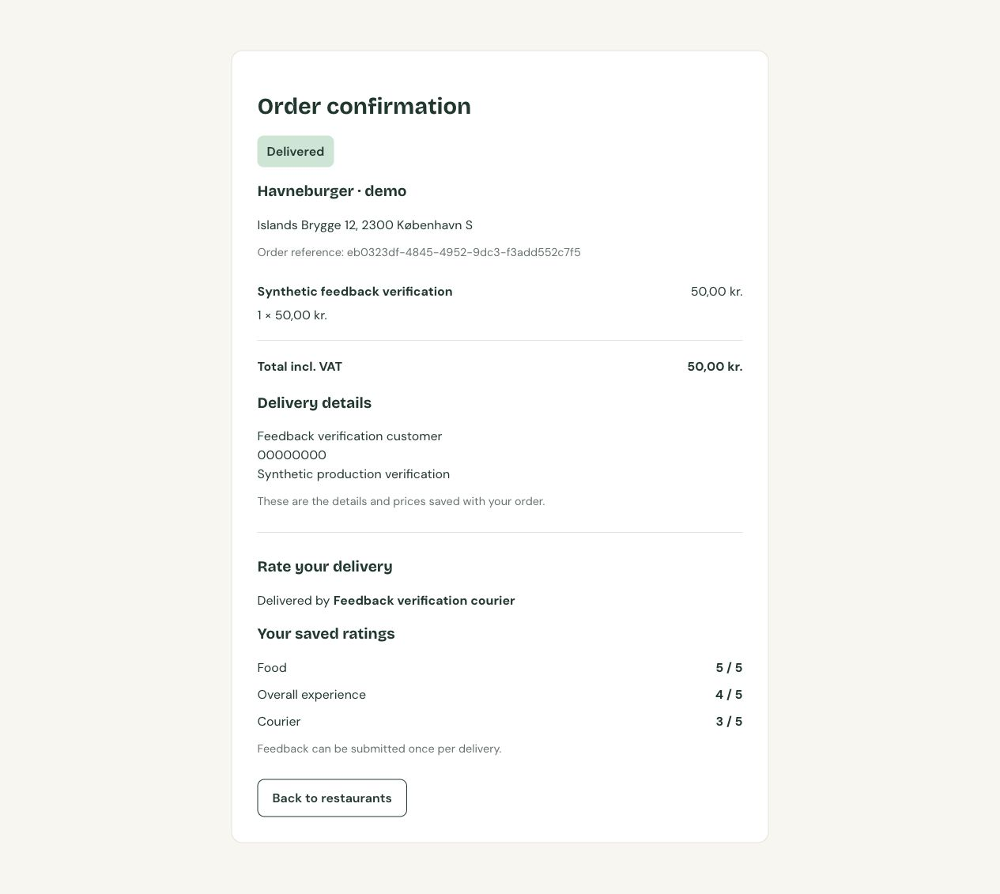

# Customer feedback production activation — 26 November 2026

Rollout: [#113](https://github.com/EmilXavierVT/MTOGO/issues/113), explicitly requested by
Emil after [product #60](https://github.com/EmilXavierVT/MTOGO/issues/60) and
[frontend #18](https://github.com/EmilXavierVT/MTOGO-Front/issues/18) were delivered.

## Active configuration

Production forwards `MTOGO_FEATURE_CUSTOMER_FEEDBACK` under the existing `mtogo-backend`
service in `/home/jetty/deployment/docker-compose.yml`. Its private `.env` now explicitly
sets the flag to true. Authenticated `GET /api/features` returns
`{"customerFeedback":true}`. The code/repository default remains false.

The rollout retained the existing database connection, JWT secret, schema-update override,
metrics port, container name, private bind address, other services and persistent volumes.
Resolved Compose candidates were compared against the original before application; only
the backend image reference and flag differed. Only the backend container was recreated.
Other running container IDs were unchanged throughout the activation exercise.

## Backup and migration

Before changes, private copies of Compose, `.env`, Caddy, container metadata and the
PostgreSQL `mtogo` database were saved. The custom-format dump was checked with
`pg_restore --list`; it was 20,387 bytes. A private copy was also retained on the operator's
machine. Credentials, resolved environment values and database contents are excluded from
this repository and public issue evidence.

Preflight found zero feedback rows, zero invalid rows and zero duplicate delivery ratings.
The [idempotent migration](../migrations/issue-60-feedback-constraints.sql) ran successfully
on production PostgreSQL 16.2. `ck_feedback_ratings` was verified as validated; existing
unique delivery and foreign-key constraints were retained. No legacy ratings were rewritten.

## Same-image verification

The exercise used backend **v0.6.0**, revision
`9c354d47a3bf787ed8d8d951c11d809c0ad40086`, pinned to:

```text
emilxvt/mtogo@sha256:605430c54aa153c87f0a741aa45ddf30be9bc7de9f2054c3901c7479cadfc559
```

Every recreation retained local image ID
`sha256:ddbdfb87d5d33fb0cfb7ab461fe3b7a186a2ae87f10c48cabfba85467ac35e41`.
Frontend remained **v0.3.0**, revision `a5ad135f1cc99ecf00dc9cd8d213f3f3b9963dac`.
Watchtower was temporarily stopped while changing configuration. Recreation used
`--no-deps --force-recreate --no-build --pull never` and waited for backend health.

| State | Completed at (Copenhagen) | Observed result |
| --- | --- | --- |
| Initial OFF | Before activation | Capability false; feedback GET/POST denied with 404; normal order read worked |
| ON | 14:52:47 | Capability true; valid delivered order exposed the assigned courier and form |
| OFF again | 14:53:36 | API denied, browser hid feedback, saved ratings and bonus remained unchanged |
| ON again | 14:54:05 | Capability true; saved result visible again |
| Normal update configuration restored, ON | 14:54:16 | Same image, healthy backend; `latest` reference and Watchtower restored |

Recreation plus health waits took 7–13 seconds each; these are command durations, not a
measurement of user-visible downtime. The final configuration leaves feedback enabled and
preserves normal automatic image updates.

## Production business checks

Verification used isolated synthetic customer accounts and orders. It did not change the
public restaurant/menu catalog or submit a rating for a real customer's order.

- The public frontend's real login and delivered-order link reached the feedback form.
  Browser submission saved food **5**, overall experience **4**, courier **3** and showed
  the same persisted result after reload and after the flag cycle.
- The saved courier ID matched the persisted delivery assignment. A second submission
  returned 409; only one feedback row existed for that delivery.
- Missing authentication returned 401. Another customer's token and a courier token
  returned 403 in both flag states.
- Premature feedback returned 409. Missing ratings, out-of-range values, fractional ratings
  and numeric strings returned 400 without creating feedback.
- The fixture's earned bonus remained **0.48 DKK** and its order remained DELIVERED.
- Five public deployment smoke checks passed. Prometheus remained reachable and its backend
  target was up. Post-activation samples showed no backend 5xx series in the 15-minute
  window and approximately 23 ms p95 for the feedback route in the five-minute window.
  All-route p95 was approximately 338 ms during authentication-heavy verification traffic.
  Final post-delivery checks are linked from #113.



Temporary verification identities and records are restricted by exact recorded UUIDs.
Their cleanup and the final post-delivery capability/health checks are recorded on #113.
Private backup/rollback material is held under the operator's MTOGO Feedback directory and
the restricted rollout directory on the server.

## Turning the feature off

Follow the [activation runbook](../customer-feedback.md#deployment-and-activation): retain
the current immutable image and schema, coordinate Watchtower, set only this flag to false,
validate Compose quietly and recreate only `mtogo-backend`. Confirm capability false,
authorized feedback denial, saved order access, health and smoke checks. Disabling the flag
preserves stored ratings and earned bonuses; do not restore a database backup to toggle it.
