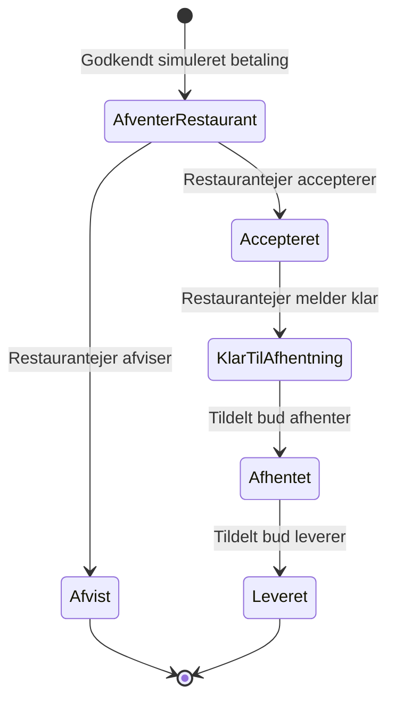

# Projektplan

Godkendt af Emil den 10. november 2026 efter projektinterviewet. Denne plan erstatter den tidligere backlog. Gamle issues er slettet og er ikke kravgrundlag.

## Ramme og mål

Fire personer har tre uger med cirka 15 timer hver pr. uge: i alt 180 persontimer. Timer til møder, review, dokumentation, tests og deployment indgår i samme budget. Startdato og kalenderfrister er ikke fastlagt.

Målet er en sammenhængende, demonstrerbar ordre fra kundens bestilling til buddets levering. Menuadministration, provision, bonus og proceskrav prioriteres højest. Feedback, engelsk og adminoversigt er planlagt, men genovervejes først ved tidspres. En ændring af scope skal aftales og dokumenteres; en lavere prioritet er ikke en beslutning om at udelade funktionen.

## Teknisk løsning

- Backend: Java og Javalin med Hibernate og PostgreSQL.
- Frontend: React med linting.
- Én modulær backend, én database og én frontend. Ansvar for konti/adgang, restauranter/menuer, ordrer/levering, økonomi og feedback holdes adskilt.
- Docker Compose starter løsningen. Konfiguration og hemmeligheder ligger uden for kildekoden; databasen har vedvarende lagring.
- Klagebehandling implementeres ikke. Modulerne og koblingen til bruger/ordre beskrives, så klager senere kan tilføjes uden at bygge ordreflowet om.

Eksisterende kode er et udgangspunkt, ikke en ny kravspecifikation. Konkrete runtimeversioner og byggekommandoer skal ensrettes mellem udvikling, CI og containere. Ingen nye tekniske værktøjer kræves alene for at gøre værktøjslisten længere.

## Konti og adgang

Alle bruger samme login. Hver konto har præcis én rolle.

| Rolle | Adgang i første version |
| --- | --- |
| Kunde | Registrere sig, bestille, se egne ordrer og afgive feedback på egne leverede ordrer. |
| Restaurantejer | Tilknyttet én restaurant; se dens ordrer og administrere dens menu. |
| Bud | Se ledige, leveringsklare ordrer og gennemføre sin egen aktive levering. |
| Admin | Se alle ordrer og deres status; læseadgang i første version. |

Restauranter, restaurantejere, bude og admin oprettes som startdata. Administration af konti gennem brugerfladen indgår ikke. Backend håndhæver både roller og ejerskab; skjulte knapper er ikke adgangskontrol. Kodeabstraktionen `User` og eventuelle rolleprofiler holdes adskilt fra disse adgangsregler.

## Menuer og sprog

Restaurantejeren kan oprette retter, ændre navn, beskrivelse og pris samt markere retter som utilgængelige. Billedupload, tilvalg og kampagner indgår ikke.

Navn og beskrivelse findes på dansk og kan tilføjes på engelsk. Engelske felter er valgfrie; manglende engelsk tekst falder tilbage til den danske tekst, også hvis kun ét felt mangler. Pris og tilgængelighed er fælles. Webappens faste tekster understøtter dansk og engelsk.

## Bestilling og priser

En ordre indeholder retter fra præcis én restaurant. Kunden angiver navn, telefon og leveringsadresse. Ordren gemmer disse oplysninger samt rettens navn, enhedspris, antal, beregningsgrundlag og beregnet provision, så senere menu- eller profilændringer ikke ændrer historikken.

Backend kontrollerer pris og tilgængelighed ved bestilling. En ændret total skal vises og accepteres af kunden før betaling. En utilgængelig ret kan ikke bestilles. Prisernes momsgrundlag skal fremgå klart og være ensartet gennem menu, kurv og checkout; provision beregnes altid af ordreværdien eksklusive moms.

Betaling er en lille lokal simulation med godkendt/afvist resultat. En afvist betaling må ikke give en betalt ordre. Reelle betalinger, SMS og beskedlog indgår ikke.

## Ordre og levering



Bud vælger selv en ledig, leveringsklar ordre. Hver ordre kan kun være tildelt ét bud, og hvert bud må højst have én aktiv levering. Overtagelsen skal ske atomisk, også når to bude forsøger samtidig. Tildeling sker inden markering som afhentet; en tildelt ordre er ikke længere ledig.

Kun restaurantens ejer ændrer restaurantens trin. Kun det tildelte bud markerer afhentet og leveret. Backend afviser ugyldige overgange og ændringer fra uvedkommende. Ordre- og leveringstidspunkter registreres konsistent, så historik og behandlingstid kan forklares.

Ved restaurantens afvisning afsluttes ordren med simuleret tilbagebetaling, uden opkrævet provision eller optjent bonus. Kundeannullering efter bestilling, delvise leveringer og afbrudte leveringer efter accept indgår ikke i første version.

## Provision og bonus

Lad `x` være ordreværdien i kroner eksklusive moms og `r(x)` være satsen som decimaltal:

```text
x >= 0
r(x) = 0.06                         for 0 <= x <= 100
r(x) = 19/300 - x/30000              for 100 < x < 1000
r(x) = 0.03                         for x >= 1000
provision = afrund_til_øre(x * r(x))
bonus = afrund_til_øre(provision * 0.20), kun ved gennemført levering
```

På det lineære interval svarer satsen i procent til `f(x) = -x/300 + 19/3`. Der er intet yderligere servicegebyr. Beregningen anvender decimalbeløb og bevarer præcision frem til afrunding af provisionsbeløbet. Penge afrundes til to decimaler; den konkrete afrundingsregel dokumenteres og bruges konsekvent i implementeringen.

| Ordreværdi ekskl. moms | Sats | Provision | Bonus ved levering |
| --- | --- | --- | --- |
| 100,00 kr. | 6 % | 6,00 kr. | 1,20 kr. |
| 250,00 kr. | 5,5 % | 13,75 kr. | 2,75 kr. |
| 500,00 kr. | 4,666… % | 23,33 kr. | 4,67 kr. |
| 950,00 kr. | 3,166… % | 30,08 kr. | 6,02 kr. |
| 1.000,00 kr. | 3 % | 30,00 kr. | 6,00 kr. |
| 1.100,00 kr. | 3 % | 33,00 kr. | 6,60 kr. |

Det lille fald i provisionsbeløb fra 950 til 1.000 kr. er accepteret som en konsekvens af den lineære sats. Modellen må ikke erstattes af marginale provisionstrin eller et ekstra gebyr.

Bonus optjenes én gang pr. gennemført levering og tilhører det tildelte bud. Gentagne kald må ikke give gentagen optjening. Ratings påvirker ikke bonus. Beregnet provision ved bestilling adskilles fra opkrævet provision og optjent bonus ved afslutning.

Bæredygtighed vurderes med eksplicitte omkostningsantagelser, bidrag efter bonus og break-even. 80 % tilbage før øvrige omkostninger er ikke i sig selv bevis for overskud. Eksempler og følsomhed skal fremgå, og antagne omkostninger må ikke fremstilles som faktiske virksomhedsdata.

## Feedback

Efter levering kan kunden én gang pr. ordre give tre bedømmelser fra 1 til 5: mad, samlet oplevelse og det konkrete bud. Kun kunden på ordren kan gøre det. Bedømmelser før levering, uden for intervallet eller gentagne indsendelser afvises. Kommentarer og moderationsværktøjer indgår ikke.

## Tre uger

| Uge | Mål | Demo |
| --- | --- | --- |
| 1 | Afklar hosting/arbejdsfordeling, fælles byggemiljø, CI, demomiljø, login, menuer, menuadministration og bestilling. | En kunde bestiller fra en menu, som restaurantejeren kan redigere. |
| 2 | Færdiggør ordreflow, budfordeling, provision/bonus, feedback, sprog og adminoversigt. | En komplet ordre gennemføres med korrekt økonomi. |
| 3 | Stabilisering, relevante grænsetilfælde, økonomiberegninger, procesdokumentation og slutdemo. | Sammenhængende demo og dokumenteret proces med ærlige mangler. |

Tests, review og dokumentation følger ændringerne fra uge 1. Uge 3 er ikke første testfase. Backlogestimater er foreløbige persontimer og genvurderes med teamet og de faktiske flowmålinger.

## Åbne afklaringer

1. Hosting: En eksisterende Linux-server eller VM foretrækkes, hvis teamet har adgang. Ingen konkret server, adresse eller udgift er aftalt. Afklar mål og adgang inden deploymentarbejdet starter; del ikke hemmeligheder i issues.
2. Arbejdsfordeling: Teamet aftaler ansvar og samarbejdsform. Faste makkerpar eller navngivne assignees er ikke besluttet.

Afklaringerne står først i backloggen. Start- og slutdatoer, personer, færdigmeldinger og måledata udfyldes først, når de er faktiske.
